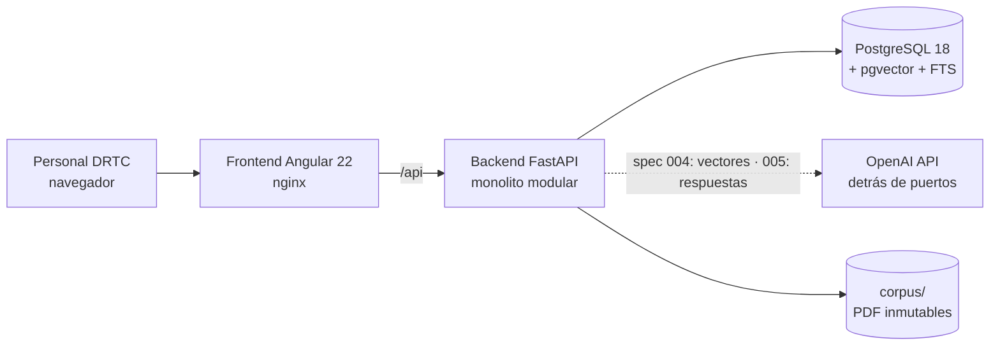

# Asistente normativo · DRTC Puno

Asistente con **citas verificables** sobre la normativa de transporte que aplica la Dirección
Regional de Transportes y Comunicaciones de Puno. Sirve para tres cosas:

1. **Responder consultas jurídicas** sobre casos, citando la disposición y la página exactas, o
   abstenerse si no hay respaldo suficiente.
2. **Leer y ubicar** partes concretas de las normas (p. ej. "artículo 218 del TUO de la LPAG").
3. **Explicar** conceptos, distinguiendo siempre texto normativo, interpretación y recomendación.

> **Estado:** Sprint 3. Los tres PDF se convierten en disposiciones estructuradas con página exacta
> (`make ingest`) y el personal ya puede **usarlas**: abrir una norma desde la Biblioteca, navegar su
> índice, leer una disposición con su estado de vigencia, historial y notas, ver la **página del PDF con
> el pasaje resaltado** (*Folio*), encontrar una disposición escribiendo su referencia (`art. 5 Ley 27181`)
> y copiar su cita. Desde el Sprint 3 también se **busca por contenido** con las propias palabras
> («plazo para apelar»): `make index` y la página «Buscar en el texto» (`/buscar`) listan las disposiciones
> que coinciden, con su fuente. **Son coincidencias, no una respuesta**: el bot que responde con citas llega
> en las specs 005-006 ([roadmap](docs/product/roadmap.md)). La búsqueda por significado necesita una clave
> de OpenAI (`DRTC_OPENAI_API_KEY`); sin ella la búsqueda funciona con palabras y lo avisa.
>
> **Aviso:** las tres ediciones cargadas son **de prueba y no están verificadas**; al menos una
> (TUO de la Ley 27444, DS 004-2019-JUS) habría sido sustituida por el DS 006-2026-JUS. Ver
> [inventario del corpus](docs/domain/corpus-inventory.md).

## Corpus inicial

| Norma | Edición cargada | Estado |
|---|---|---|
| Ley N.° 27181, Ley General de Transporte y Tránsito Terrestre | Compilación no oficial (modificaciones hasta mayo de 2020) | No verificado |
| DS N.° 017-2009-MTC, Reglamento Nacional de Administración de Transporte | Edición del MTC actualizada al 04-01-2017 | No verificado |
| TUO de la Ley N.° 27444, LPAG (DS 004-2019-JUS) | Segunda Edición Oficial MINJUSDH (julio de 2021) | No verificado |

## Arquitectura en una mirada



- **Backend:** Clean Architecture + DDD + SOLID. Bounded contexts `legal_corpus`, `ingestion`,
  `retrieval`, `consultation`, `identity`; reglas de dependencia verificadas con import-linter.
  → [docs/architecture/backend.md](docs/architecture/backend.md)
- **Frontend:** Angular estándar (core / layout / shared / features con data-access, feature, ui).
  → [docs/architecture/frontend.md](docs/architecture/frontend.md)
- **Proceso:** Spec-Driven Development (GitHub Spec Kit) + Scrum-lite.
  → [docs/process/way-of-working.md](docs/process/way-of-working.md)

## Inicio rápido

Requisitos: [uv](https://docs.astral.sh/uv/), [nvm](https://github.com/nvm-sh/nvm) (Node 26, ver
`.nvmrc`), Docker con Compose y `make`.

```bash
cp .env.example .env
make bootstrap        # dependencias del backend y del frontend + hooks de git
make dev-db           # PostgreSQL + pgvector en localhost:5433
make migrate          # extensiones y tablas del corpus
make ingest           # ingiere los tres PDF (aprobación automática solo en desarrollo)
make index            # prepara la búsqueda por palabras (se puede repetir)
make dev-backend      # API en http://localhost:8000 (docs: /api/docs)
make dev-frontend     # interfaz en http://localhost:4200
```

La búsqueda por **significado** es opcional: pon `DRTC_OPENAI_API_KEY` en `.env` (nunca en el código) y
ejecuta `make embed`, que **muestra el costo estimado y pide confirmación** antes de enviar nada. Sin clave,
`/buscar` responde con palabras y lo avisa. Cómo medir la calidad: [evaluation/README.md](evaluation/README.md).

O todo en contenedores: `make up` → http://localhost:8080. Detalles y solución de problemas en
[docs/operations/local-setup.md](docs/operations/local-setup.md).

## Calidad

```bash
make check   # ruff, mypy, contratos de arquitectura, pytest, eslint, prettier, vitest, build
make e2e     # Playwright + accesibilidad (axe)
make eval    # compuerta de evaluación de la búsqueda (sin red ni costo)
```

## Estructura del repositorio

```text
backend/      API FastAPI (src/drtc_chatbot/{bootstrap,shared_kernel,contexts,entrypoints})
frontend/     Aplicación Angular (src/app/{core,layout,shared,features})
specs/        Especificaciones por funcionalidad (Spec Kit)
docs/         Producto, dominio, arquitectura (ADR), proceso, UX y operación
corpus/       PDF originales inmutables + manifest.yaml (fuente de verdad del corpus)
evaluation/   Golden set de preguntas jurídicas para medir la calidad
infra/        Despliegue (producción en R1)
.specify/     Constitución y plantillas de Spec Kit
```

## Documentación

Empiece por [docs/README.md](docs/README.md). Para contribuir: [CONTRIBUTING.md](CONTRIBUTING.md).
