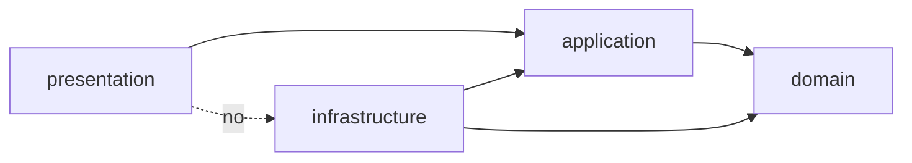

# Backend: Clean Architecture + DDD + SOLID

## Estructura

```text
backend/
├── pyproject.toml          dependencias (uv) y configuración de ruff, mypy, pytest, import-linter
├── openapi.json            contrato de la API (generado, versionado, verificado en CI)
├── alembic.ini · migrations/
├── src/drtc_chatbot/
│   ├── main.py             app = create_app()
│   ├── bootstrap/          raíz de composición: settings, logging, container
│   ├── shared_kernel/      Entity, AggregateRoot, DomainEvent, errores, Actor, puertos transversales
│   ├── contexts/
│   │   └── <contexto>/
│   │       ├── domain/          entidades, objetos de valor, servicios de dominio (Python puro)
│   │       ├── application/     casos de uso (queries/, commands/), DTO, puertos
│   │       ├── infrastructure/  adaptadores: SQLAlchemy, archivos, OpenAI, PyMuPDF
│   │       ├── presentation/    http/ (routers FastAPI), cli/
│   │       ├── api.py           fachada pública para otros contextos
│   │       └── README.md        responsabilidad y lenguaje del contexto
│   └── entrypoints/http/   create_app, middleware, errores RFC 9457, health, export de OpenAPI
└── tests/{unit,integration,e2e,architecture}/
```

## Regla de dependencias



Las reglas viven en `pyproject.toml` (`[tool.importlinter]`) y corren en `make arch`, en la suite de
tests (`tests/architecture`) y en CI:

1. Capas dentro de cada contexto (`presentation | infrastructure → application → domain`).
2. Dominio sin frameworks (fastapi, starlette, pydantic, sqlalchemy, psycopg, httpx, yaml, structlog).
3. Aplicación sin frameworks de entrega ni persistencia.
4. Contextos independientes entre sí, salvo a través de `api.py`.
5. Ni los contextos ni el shared kernel dependen de `bootstrap` o `entrypoints`.

## Recorrido de una petición (corte de la spec 001)

```text
GET /api/v1/instruments
 → entrypoints/http/app.py               (RequestIdMiddleware, CORS, manejo de errores)
 → legal_corpus/presentation/http/router.py
     · CurrentActor  (shared_kernel/presentation/http.py → IdentityProvider anónimo)
     · LegalCorpus   (Protocol; el container lo dejó en app.state.legal_corpus)
 → legal_corpus/application/queries/list_legal_instruments.py   (caso de uso)
     · puerto LegalInstrumentCatalog (application/ports.py)
 → legal_corpus/infrastructure/manifest_catalog.py   (adaptador: lee corpus/manifest.yaml)
     · mapea a entidades de domain/legal_instrument.py
 ← DTO LegalInstrumentSummary → schema Pydantic LegalInstrumentOut → JSON
```

En la spec 002 el adaptador se reemplaza por un repositorio PostgreSQL en `bootstrap/container.py`
**sin tocar el caso de uso ni el router**: ese es el punto de la inversión de dependencias.

## Lectura y referencias (spec 003)

| Ruta | Caso de uso | Puerto → adaptador |
|---|---|---|
| `GET /instruments/{id}/outline` | `GetOutline` | `ReadingStore` → `SqlReadingStore` |
| `GET /instruments/{id}/reading-unit?path=` | `GetReadingUnit` (arma las citas con `domain/citations.py`) | `ReadingStore` → `SqlReadingStore` |
| `GET /versions/{id}/source` | `GetSourceDocument` | `DocumentStorage` → `LocalDocumentStorage` (verifica el SHA-256; en producción puede ser MinIO) |
| `GET /lookup?q=` | `LookupReference` (contexto `retrieval`) | `ProvisionDirectory` → `LegalCorpusDirectory` (usa solo `legal_corpus.api`) |

- El **dominio decide** la unidad de lectura (`reading_unit_path`) y redacta las citas; el router solo
  traduce a JSON. El orden de las disposiciones es el de su **primera revisión** en el documento, para que
  un texto sustituido no salte al lugar donde se cita su reemplazo.
- `IntegrityViolationError` (el PDF no coincide con su huella) responde `500` con un mensaje genérico y deja
  el detalle en el registro; nunca revela rutas.
- El servicio de PDF no recibe rutas del cliente: solo el id de una edición aprobada.

## Patrones

| Patrón | Dónde | Nota |
|---|---|---|
| Agregado / raíz | `LegalInstrument`, `Conversation` (005) | Invariantes en el constructor y en métodos de la raíz |
| Objeto de valor | `InstrumentId`, `PageRange`, `Sha256Digest` | `@dataclass(frozen=True, slots=True)` + validación en `__post_init__` |
| Puerto / adaptador | `LegalInstrumentCatalog`, `IdentityProvider`, `AnswerGenerator` (005) | `typing.Protocol` definido por la capa interna |
| Caso de uso | `ListLegalInstruments` | Una operación por clase; recibe `Actor`; devuelve DTO |
| Unit of Work | `shared_kernel/application/unit_of_work.py` | Implementación SQLAlchemy con la primera escritura (spec 002) |
| Eventos de dominio | `AggregateRoot.pull_events()` | Se despachan tras el commit |
| Raíz de composición | `bootstrap/container.py` | Cableado manual; sin framework de DI (ADR-0002) |
| Errores | `DomainError.code` → RFC 9457 | Códigos estables para el frontend |

## SOLID en la práctica

- **S:** un caso de uso por clase; routers solo traducen HTTP ↔ caso de uso.
- **O:** nuevas fuentes de datos, proveedores de IA o de identidad = nuevos adaptadores.
- **L:** cualquier adaptador de un puerto es intercambiable (los tests usan fakes en memoria).
- **I:** puertos pequeños por necesidad (`LegalInstrumentCatalog` solo lista).
- **D:** la capa interna define el puerto; la externa lo implementa; `bootstrap` los une.

## Convenciones

- Python 3.14, tipado estricto (mypy `strict`), ruff, imports absolutos.
- Configuración por variables `DRTC_*` (`bootstrap/settings.py`).
- Logs estructurados (structlog) con `request_id`; JSON en contenedores.
- Rutas bajo `/api/v1`; documentación interactiva en `/api/docs`; contrato en `/api/openapi.json`.
- Migraciones con Alembic (`backend/migrations`), nombradas `AAAA_MM_DD_<rev>_<slug>.py`.
