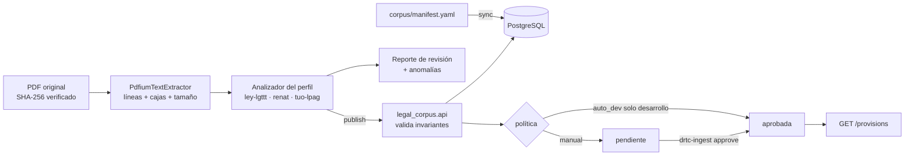

# Ingesta de documentos (spec 002)

Cómo se convierte un PDF en disposiciones citables. Decisiones: [ADR-0011](adr/0011-ingestion-approval-policy.md),
[ADR-0012](adr/0012-pypdfium2-for-pdf-extraction.md).

## Estados de una corrida

`received → extracted → parsed → published` (o `failed`). Cada corrida queda en `ingestion_jobs` con su
reporte. Re-ejecutar con el mismo PDF y el mismo analizador da el mismo `content_digest` y no cambia
nada (idempotencia). El digest incluye el texto, las **advertencias de revisión** y las cajas (redondeadas):
si cambia cualquiera de ellas, la corrida se considera una actualización.

Las advertencias de revisión (`review_flags`) se guardan **por revisión** y las muestra el lector; el
reporte de la corrida ya no es lo único que las recuerda.

## El analizador (`ingestion/domain/parsing`)

Python puro, una sola pasada sobre las líneas. **La estructura decide qué está vigente; las notas solo
explican por qué.**

| Situación en el PDF | Resultado |
|---|---|
| `Artículo N.- Título` sin comillas | Texto original del artículo (revisión 1) |
| `“Artículo N …”` ya existente | **Sustituye**: el texto anterior y todo lo que está debajo pasan a `superseded` |
| `“Artículo 4-A …”` nuevo | **Incorpora** una disposición nueva |
| `“5.2 …”` / `"g) …"` dentro de un artículo | Sustituye o incorpora solo ese numeral o literal |
| `(*) … modificado por … cuyo texto es el siguiente:` | Da el **evento** (norma y fecha) al bloque que sigue |
| `(*) Párrafo modificado …` | **Anomalía**: el párrafo nuevo se guarda como nota; no se aplica por conjetura |
| `CONCORDANCIAS:`, `NOTA SPIJ`, notas al pie | Notas editoriales ligadas a la disposición |
| Texto tras un bloque citado | Se adjunta a la disposición anterior y se marca para revisión |
| Líneas en letra pequeña (TUO) | Notas al pie, incluso si traen el texto anterior de varias páginas |

**Anexos.** Un anexo es una sola disposición cuyo texto es lo que siga hasta el próximo anexo (modo de texto
plano). Las tablas no se estructuran: se guarda solo la caja del encabezado para resaltar, y la
revisión lleva la advertencia `annex_table_unstructured`. (Antes, la tabla del anexo 2 del RENAT acababa
como notas y el anexo quedaba con 182 caracteres.)

**Llamadas a nota en títulos.** En el TUO un número en superíndice puede quedar pegado al título
("…N° 1272)115"): se elimina solo si sigue a un paréntesis de cierre, igual que en el texto de los
artículos.

Perfiles (`profiles.py`): `ley-lgttt` (sin ajustes), `renat` (el decreto aprobatorio es preámbulo; arranca en
"REGLAMENTO NACIONAL…"), `tuo-lpag` (arranca en "TÍTULO PRELIMINAR", artículos romanos, notas al pie por
tamaño, ruido de encabezados). Para una norma nueva se añade un perfil y, si hace falta, una opción del motor.

## Qué hacer cuando aparece una anomalía

El reporte (`drtc-ingest run`/`report`) agrupa las anomalías por código con ejemplos de página y ruta.
Para cada una, el revisor abre esa página del PDF y decide; las correcciones de reglas del analizador
se hacen en `engine.py` con una prueba que reproduzca el caso (idealmente con un fragmento del PDF
real, como en `tests/unit/ingestion/test_article_parser.py`).

## Pruebas

- `tests/unit/ingestion`: fragmentos reales de cada patrón.
- `tests/integration/ingestion/test_real_corpus.py`: artículos exactos de los tres PDF, invariantes y
  localización del golden set (SC-005).
- `tests/e2e/test_provisions_api.py`, `test_ingest_cli.py`: ingesta de la Ley 27181 en PostgreSQL y lectura
  por API/CLI.
- `tests/e2e/test_reader_api.py`, `test_lookup_api.py`: el lector y la búsqueda por referencia sobre las tres
  normas reales (ver [spec 003](../../specs/003-legal-reader/spec.md)).
