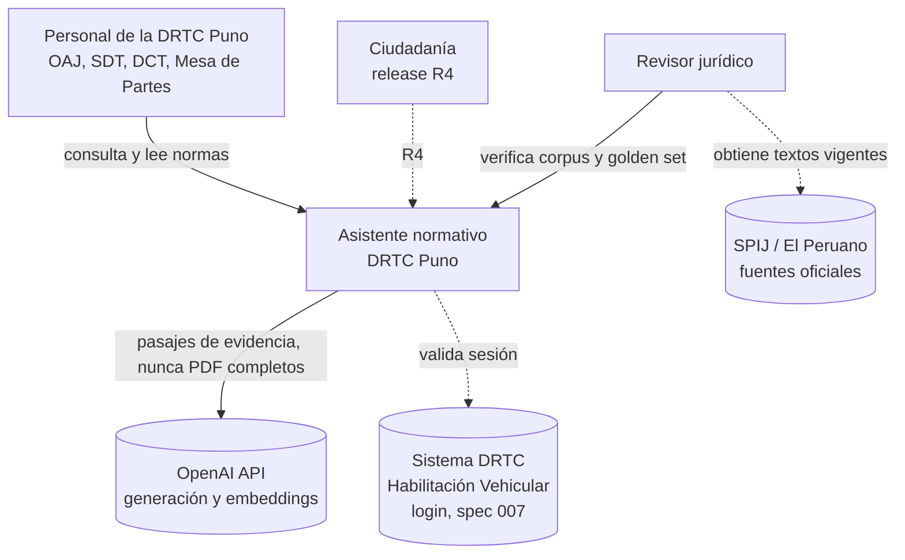
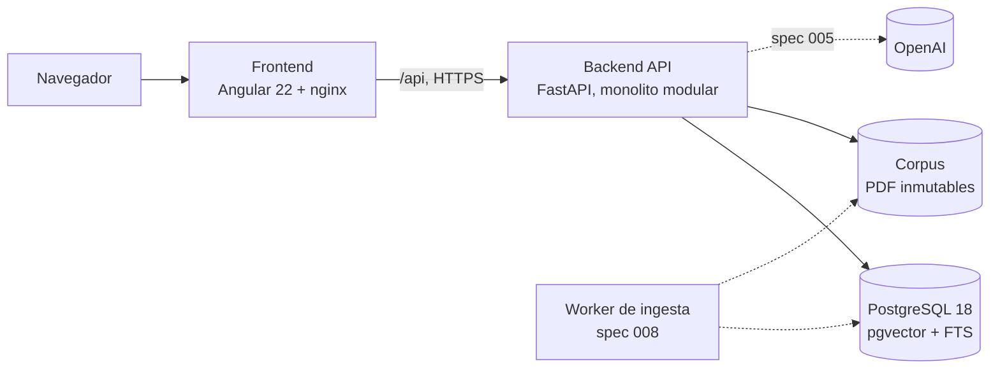
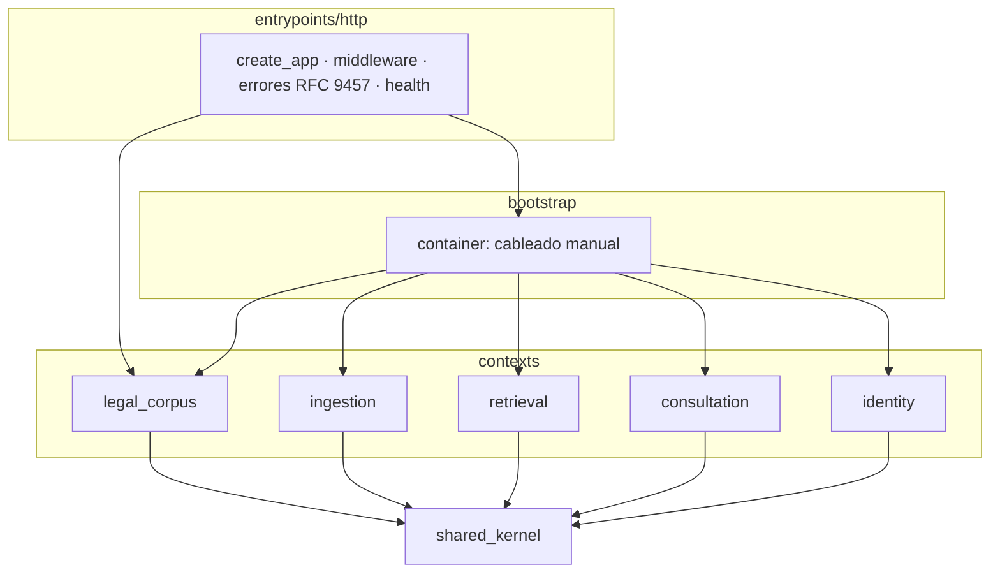

# Visión general de la arquitectura (C4)

Basada en la [arquitectura de referencia](reference/arquitectura_rag_consultoria_legal_peru.md):
**monolito modular**, PostgreSQL como fuente de verdad jurídica, búsqueda híbrida y validación de
citas. Las diferencias están en [ADR-0010](adr/0010-deviations-from-reference-architecture.md).

## Nivel 1 — Contexto

## Nivel 2 — Contenedores

- **Frontend:** SPA servida por nginx, que además hace de proxy de `/api` (mismo origen, SSE).
- **Backend:** API sin estado (escalable horizontalmente). La ingesta corre por CLI hasta la spec 008,
  donde se separa en un worker con el mismo código y otro punto de entrada.
- **PostgreSQL:** registro canónico del corpus, índice textual y vectorial (reconstruible).
- **Corpus:** PDF originales; en producción, almacenamiento compatible con S3 (MinIO, como el
  sistema DRTC) detrás del puerto `DocumentStorage`.

## Nivel 3 — Componentes del backend

Cada contexto tiene `domain / application / infrastructure / presentation` y una fachada `api.py`.
Detalle en [backend.md](backend.md).

## Atributos de calidad y cómo se logran

| Atributo | Mecanismo |
|---|---|
| Mantenibilidad | Bounded contexts, regla de dependencias verificada (import-linter), ADR |
| Escalabilidad | API sin estado, índice derivado, worker separable, OpenSearch solo si llegan decenas de miles de documentos |
| Robustez | Tipado estricto (mypy, TS strict), validación de entrada, estados explícitos, health checks |
| Trazabilidad jurídica | SHA-256 de fuentes, versiones inmutables, citas validadas, `request_id` |
| Seguridad | Claves solo en el servidor, mínimos datos a terceros, contenedores no-root |
| Usabilidad | Sello de vigencia, citas verificables, WCAG 2.2 AA |
