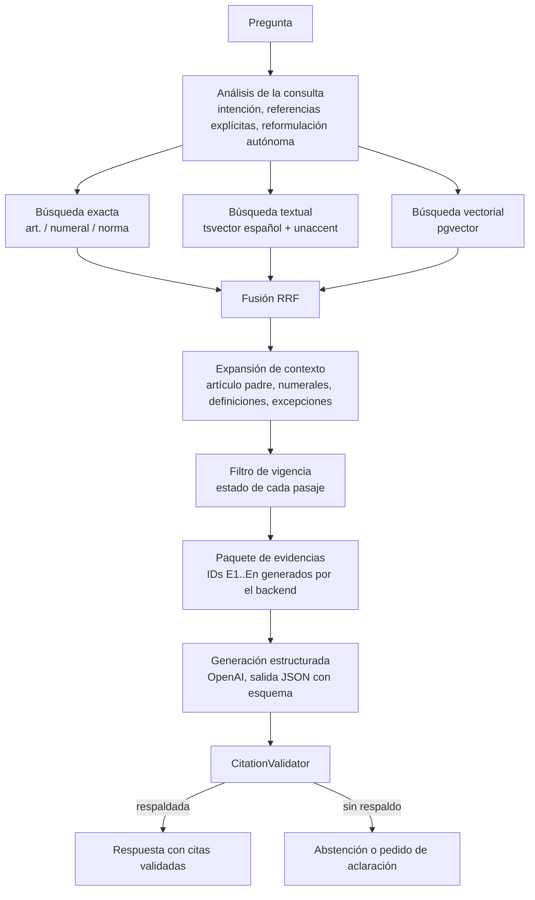

# Pipeline de recuperación y respuestas citadas (specs 004-005)

Diseño objetivo; se implementará y ajustará con evidencia del golden set. Basado en las §6-7 de la
arquitectura de referencia.



## Decisiones clave

1. **Recuperación exacta primero.** Si la pregunta nombra una disposición, se recupera por
   identificador antes que por similitud.
2. **Fragmentación jurídica**, no por tamaño fijo: artículo como padre; numeral/literal como hijo; cada
   hijo incluye la ruta del padre ("Ley 27181 › Título I › Art. 2 › lit. e").
3. **Embeddings (OpenAI):** el modelo se elige en la spec 004 por Recall@K. Con pgvector, los índices
   HNSW de `vector` admiten hasta 2000 dimensiones (`halfvec` hasta 4000): si el modelo produce más,
   se reduce con el parámetro de dimensiones o se usa `halfvec`.
4. **Reranker:** solo si la evaluación muestra que mejora la precisión de los primeros pasajes
   (no hay reranker de OpenAI; las opciones se evaluarán en su momento).
5. **Generación estructurada:** el modelo recibe la pregunta, los pasajes y sus metadatos, y devuelve
   JSON con `conclusion`, `legal_basis`, `analysis`, `exceptions_and_limits`, `claims[]` (cada una con
   `evidence_ids` y cita textual opcional), `insufficient_evidence` y `clarifying_question`.
6. **Validación determinista** en el dominio (`CitationValidator`): IDs existentes en el paquete, cita
   textual que sea subcadena exacta (normalizando espacios) del pasaje, disposición aprobada y estado
   de vigencia informado. Lo que no se valida no se muestra.
7. **Mostrar solo lo validado** ("validate-then-reveal"): por SSE se envían el progreso y las fuentes
   encontradas; la respuesta aparece cuando está validada.
8. **Prompts versionados** como archivos; cada consulta registra proveedor, modelo, versión de prompt,
   tokens, costo estimado y latencia.
9. **Defensa ante prompt injection:** los pasajes van delimitados como datos; las instrucciones del
   sistema prohíben seguir instrucciones del contenido; la salida se valida contra el esquema.
10. **Línea base de evaluación:** el corpus completo cabe en la ventana de contexto de los modelos
    actuales; ese modo "contexto largo" se usará solo como referencia de evaluación, no en producción
    (costo, latencia, control de vigencia).

## Puertos previstos (contexto `consultation`)

```python
class QueryAnalyzer(Protocol):
    async def analyze(self, question: str, history: Sequence[Turn]) -> QueryAnalysis: ...

class EvidenceRetriever(Protocol):
    async def retrieve(self, analysis: QueryAnalysis) -> EvidencePack: ...

class AnswerGenerator(Protocol):
    async def generate(self, request: GenerationRequest) -> DraftAnswer: ...
```

Los adaptadores OpenAI viven en `consultation/infrastructure/` y `retrieval/infrastructure/`; el modelo
y los IDs de modelo vienen de la configuración (`DRTC_OPENAI_*`), nunca del código.
