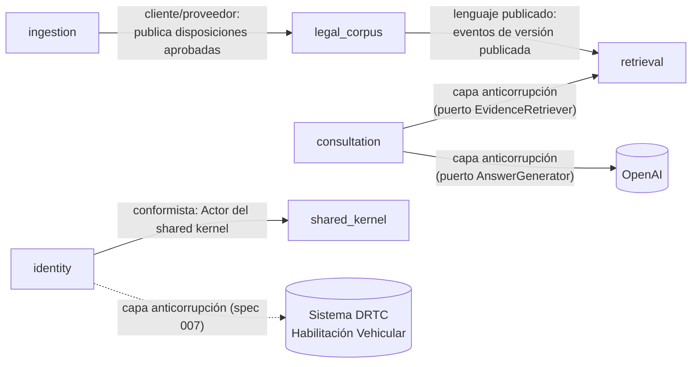

# Mapa de contextos

## Subdominios

| Contexto | Tipo | Por qué |
|---|---|---|
| `legal_corpus` | **Principal** | Saber qué dice la norma vigente y cómo lo sabemos es el corazón del producto. |
| `retrieval` | **Principal** | La calidad del asistente depende de encontrar la evidencia correcta. |
| `consultation` | **Principal** | Respuestas citadas y abstención: lo que el usuario percibe. |
| `ingestion` | Soporte | Necesario pero no diferencial: convierte PDF en disposiciones revisables. |
| `identity` | Genérico | Autenticación y roles; se integrará con el sistema DRTC existente. |
| `shared_kernel` | — | Bloques compartidos mínimos: `Entity`, `AggregateRoot`, `DomainEvent`, `Actor`, puertos transversales. |

## Relaciones

- **ingestion → legal_corpus (cliente/proveedor):** la ingesta solo publica a través de
  `contexts.legal_corpus.api`; nunca escribe en las tablas del corpus.
- **legal_corpus → retrieval (lenguaje publicado):** el índice es un modelo derivado y
  reconstruible; se actualiza cuando se publica una versión aprobada. Desde la spec 003 `retrieval`
  existe: resuelve **referencias exactas** leyendo el índice de disposiciones únicamente a través de
  `contexts.legal_corpus.api` (puerto `ProvisionDirectory`, capa anticorrupción). Desde la spec 004
  también **busca por contenido**: lee los pasajes vigentes (`ListIndexablePassages`) y las ediciones
  aprobadas (`ListApprovedEditions`) por la misma puerta, construye su propio índice derivado
  (palabras + vectores, `retrieval_*`) y lo reconstruye cuando cambia el texto. `legal_corpus` no sabe
  que ese índice existe.
- **consultation → retrieval (ACL):** `consultation` define su propio puerto `EvidenceRetriever` con
  sus propios tipos; un adaptador traduce desde `contexts.retrieval.api`.
- **Sistemas externos:** OpenAI y el sistema DRTC quedan detrás de adaptadores; cambiar de proveedor
  no toca el dominio.

## Reglas técnicas que hacen cumplir el mapa

Definidas en `backend/pyproject.toml` (`[tool.importlinter]`) y verificadas en CI:

1. Capas dentro de cada contexto: `presentation | infrastructure → application → domain`.
2. Dominios sin frameworks; aplicación sin FastAPI/SQLAlchemy/HTTP.
3. Entre contextos solo vía `api.py`.
4. Contextos y shared kernel no dependen de `bootstrap` ni de `entrypoints`.
