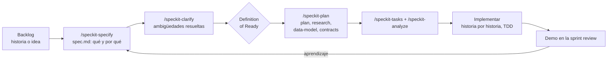

# Forma de trabajo: Spec-Driven Development + Scrum-lite

## Principio

Especificamos **lo justo y a tiempo**: la spec del próximo incremento está clara antes de programarlo;
lo que viene después es solo una línea en el [roadmap](../product/roadmap.md). Las specs son documentos
vivos que cambian junto con el código.

## Ciclo de una funcionalidad

1. **Specify:** historias priorizadas (P1, P2, P3), cada una demostrable por sí sola, con escenarios
   *Dado / Cuando / Entonces*, requisitos `FR-xxx` y criterios de éxito `SC-xxx`, sin detalles de
   implementación.
2. **Clarify:** las dudas se marcan `[NEEDS CLARIFICATION: …]` y se resuelven con el revisor
   jurídico o el responsable de producto antes de planificar.
3. **Plan:** diseño técnico verificado contra la [constitución](../../.specify/memory/constitution.md);
   contratos OpenAPI en `contracts/`; investigación en `research.md`.
4. **Tasks:** tareas `Txxx` agrupadas por historia; `[P]` marca tareas paralelizables.
5. **Implement:** primero la historia P1 completa (corte vertical), luego P2…; cada historia termina
   cumpliendo la Definition of Done.

## Cadencia (equipo de 2-4 personas)

| Evento | Cuándo | Duración | Resultado |
|---|---|---|---|
| Sprint | Cada 2 semanas | — | 1-2 historias de una spec, demostrables |
| Planificación | Día 1 | 1 h | Objetivo del sprint; specs listas (DoR) |
| Refinamiento | Mitad del sprint | 45 min | Spec del siguiente sprint clarificada |
| Daily | Diario | 10 min | Bloqueos visibles |
| Review / demo | Último día | 45 min | Demo a un usuario de la DRTC; feedback al backlog |
| Retrospectiva | Último día | 30 min | Mejoras al proceso o a la constitución |

Tablero en **GitHub Projects**: *Backlog → Ready → En curso → En revisión → Hecho*. Cada tarjeta
enlaza su spec. Plantillas de issue: historia, error y spike.

## Roles

- **Responsable de producto / revisor jurídico** (hoy, el líder del proyecto): prioriza el backlog,
  aprueba specs con impacto jurídico y el golden set. Mientras no haya un abogado de la OAJ, toda
  respuesta lleva el aviso "Orientativo · no validado por OAJ".
- **Equipo de desarrollo:** especifica con el responsable, diseña, implementa, prueba y demuestra.
- **Facilitador** (rotativo): cuida la cadencia y los impedimentos.

## Uso de Claude Code

- Los comandos `/speckit-*` están instalados como skills en `.claude/skills/`.
- `CLAUDE.md` y `frontend/CLAUDE.md` contienen las reglas del repositorio.
- Claude Code no hace commits sin que se le pida; los cambios se revisan en PR como cualquier otro.
