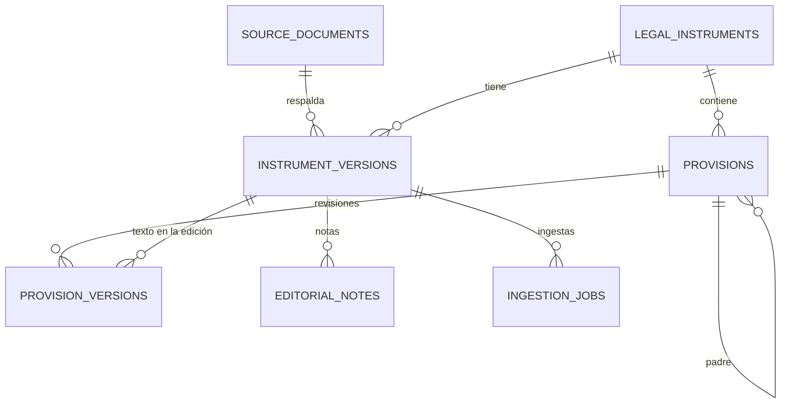

# Modelo de datos (migración `0002`)

| Tabla | Idea |
|---|---|
| `source_documents` | PDF original: id del manifiesto, nombre, `sha256` único, páginas. Si el hash cambia, `sync` falla |
| `legal_instruments` | Norma (slug estable) con su orden de catálogo |
| `instrument_versions` | Edición: estado de verificación, `approval_status/mode/by/at`, `content_digest`, `parser`, secciones de páginas |
| `provisions` | Identidad estable de una disposición **dentro de la norma**: `structural_path` único (`articulo:2/literal:e`), tipo, etiqueta, padre |
| `provision_versions` | **Una revisión de texto en una edición**: `revision` 1..n, `status` current/superseded, título, texto, páginas, `boxes` (JSONB), `event` (JSONB: norma que lo sustituyó/incorporó) |
| `editorial_notes` | Notas `(*)`, notas al pie, concordancias y preámbulo, ligadas a la ruta de la disposición |
| `ingestion_jobs` | Auditoría de cada corrida: estado, digest, reporte de revisión (JSONB), error |

## Invariantes

- **Un solo texto vigente**: índice único parcial `uq_provision_versions_one_current (provision_id,
  instrument_version_id) WHERE status = 'current'`. La base de datos lo impone además del dominio.
- Las revisiones se numeran 1..n sin saltos y solo la última puede ser vigente (`validate_revision_set`).
- Nunca se sobrescribe un texto: re-publicar contenido distinto reemplaza **todas** las revisiones de esa
  edición dentro de una transacción y devuelve la edición a `pending`.
- `approval_status = approved` exige modo, responsable y fecha; no toca `verification_status`.

## Rutas estructurales

`titulo:I` · `titulo:I/capitulo:II` · `articulo:2` · `articulo:2/literal:e` · `articulo:4-A/numeral:4-A.1/literal:a`
· `articulo:IV` (preliminar del TUO) · `disposiciones:finales/tercera` · `anexo:2`. Los contenedores
(sección, título, capítulo) incluyen a sus ancestros; los artículos no (un artículo se cita igual
sin importar su título).
